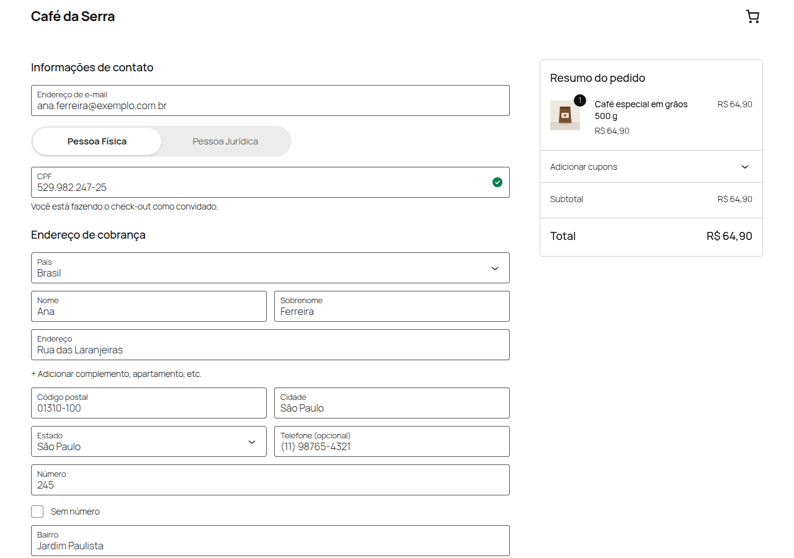
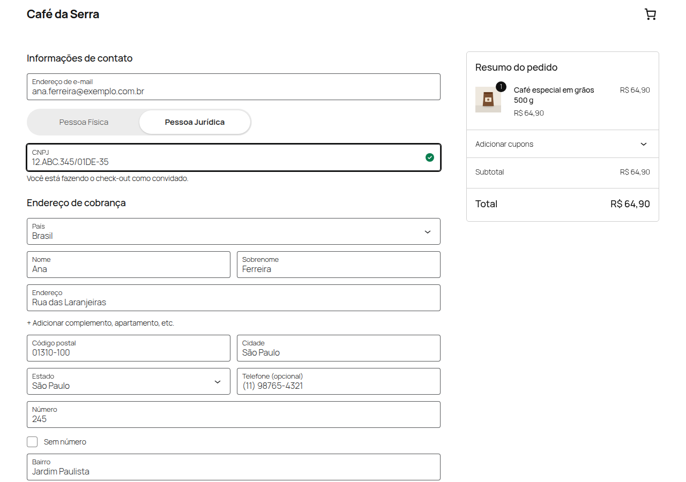
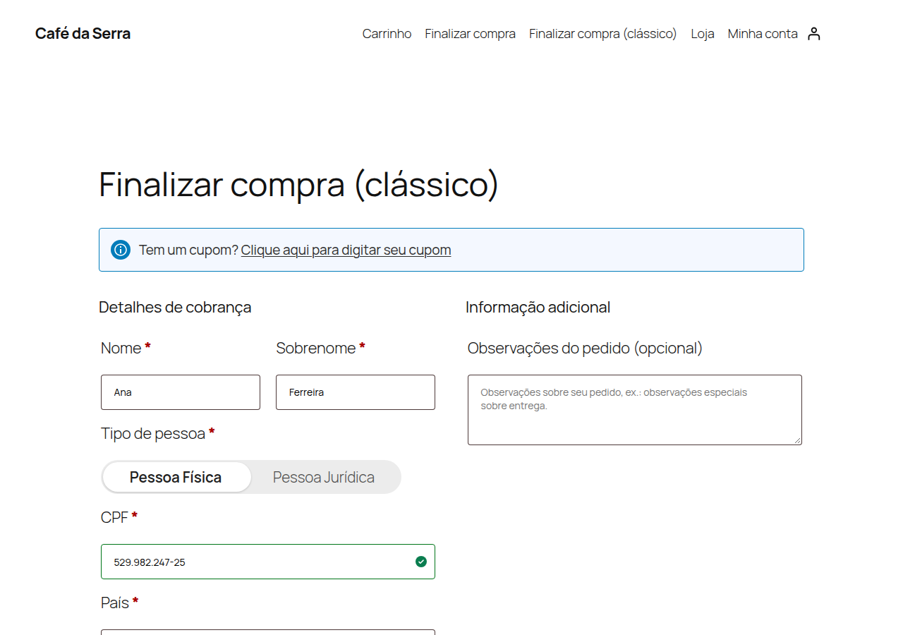
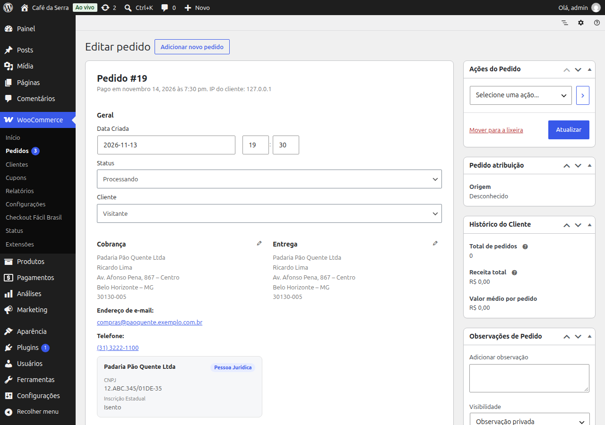
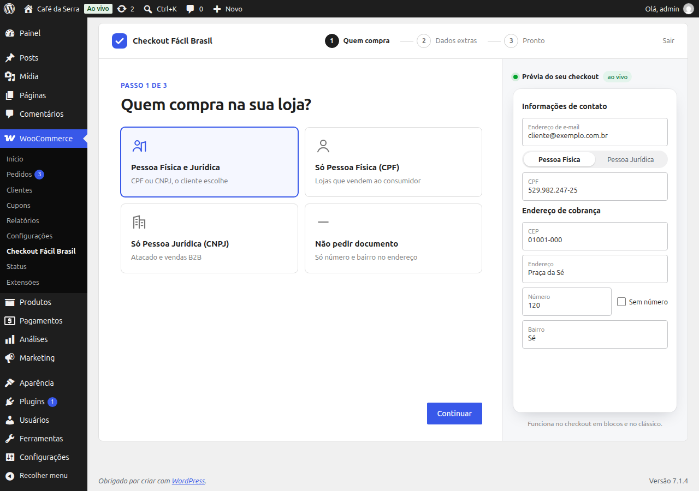

# Checkout Fácil Brasil para WooCommerce

**O que é:** um plugin gratuito para WordPress que coloca CPF, CNPJ (inclusive o novo CNPJ alfanumérico), número e bairro no checkout do WooCommerce, em blocos e clássico, e confere cada documento enquanto o cliente digita.

**Para quem é:** lojas WooCommerce que vendem para o Brasil, para pessoas físicas, empresas ou as duas, inclusive quem hoje usa o Brazilian Market on WooCommerce.

**Como usar:** 1) envie o zip em Plugins → Adicionar novo → Enviar plugin e ative, 2) em WooCommerce → Checkout Fácil Brasil, siga os três passos, 3) faça um pedido de teste no seu checkout.

Ele não emite nota fiscal (NF-e) nem calcula impostos: coleta e valida os dados que seu plugin de NF-e e de pagamento já leem.

**[Baixar checkout-facil-brasil.zip](https://github.com/Facilo-es/checkout-facil-brasil/releases/latest/download/checkout-facil-brasil.zip)** (versão mais recente) · Grátis, sem teste e sem nada bloqueado · [Leer en español](#en-español)

## O que seu cliente vê

*Checkout em blocos, Pessoa Física: o cliente escolhe o tipo de pessoa, digita o CPF com máscara e vê na hora se está certo. Número e bairro entram no endereço, com a opção "Sem número".*

*Pessoa Jurídica: só aparece o campo CNPJ, e o CNPJ alfanumérico (letras nas 12 primeiras posições) é aceito como o numérico.*

*O checkout clássico (shortcode) recebe os mesmos campos e salva os mesmos dados.*

## O que você vê

*No pedido: o tipo de pessoa, o CNPJ ou CPF e a Inscrição Estadual num cartão, ao lado dos endereços. Também aparecem nos e-mails, na página de obrigado, em Minha conta e na API REST.*

*A configuração em três passos, com uma prévia ao vivo do seu checkout.*

## O que sua loja ganha

- **Menos carrinhos abandonados:** o cliente escolhe Pessoa Física ou Jurídica e só vê os campos de que precisa, com máscara e mensagens claras para acertar o CPF ou CNPJ de primeira.
- **Empresas novas também compram:** o CNPJ alfanumérico, emitido desde julho de 2026, é aceito. A razão social é obrigatória para empresas.
- **Endereços que a transportadora entrega:** número e bairro na cobrança e na entrega, com "Sem número", escondidos para outros países.
- **Pagamento e NF-e continuam funcionando:** os dados ficam nas mesmas chaves do plugin antigo (`_billing_cpf`, `_billing_cnpj`, `_billing_number`, `_billing_neighborhood` e as demais), em pedidos de blocos e clássicos, com HPOS ligado ou desligado.
- **Campos extras opcionais:** celular, RG, Inscrição Estadual (com Isento), data de nascimento e gênero. Cada um pode ficar desligado, opcional ou obrigatório.
- **LGPD:** um texto sugerido para a política de privacidade, mais exportação e exclusão de dados pessoais para cada campo. O plugin não faz nenhuma chamada a servidores externos: os dados ficam na sua loja.

## Baixar e instalar

1. Baixe **[checkout-facil-brasil.zip](https://github.com/Facilo-es/checkout-facil-brasil/releases/latest/download/checkout-facil-brasil.zip)** (versão mais recente).
2. No WordPress, vá em **Plugins → Adicionar novo → Enviar plugin**, escolha o zip e ative. O WooCommerce precisa estar ativo.
3. Abra **WooCommerce → Checkout Fácil Brasil**, siga os três passos (quem compra, quais campos, pronto) e faça um pedido de teste.

Se o Brazilian Market on WooCommerce estiver ativo, as configurações dele são importadas e um aviso oferece desativá-lo. Nossos campos aparecem quando o plugin antigo é desligado, para nada aparecer em dobro.

**Atualizações:** por enquanto, as novas versões saem como [release no GitHub](https://github.com/Facilo-es/checkout-facil-brasil/releases): baixe o novo zip e envie do mesmo jeito, e o WordPress oferece substituir a versão instalada.

## Checkout Fácil Brasil Pro: menos digitação, mais pedidos fechados

O Pro é um plugin pago separado, que funciona junto com este gratuito. O código dele não está neste repositório.

- **Endereço pelo CEP:** rua, bairro, cidade e estado se preenchem sozinhos.
- **Dados da empresa pelo CNPJ:** razão social e endereço se preenchem, com um selo de situação cadastral no pedido.
- **Inscrição Estadual conferida** para cada um dos 27 estados.
- **Cadastro e login com CPF ou CNPJ**, e uma coluna e busca por CPF/CNPJ na lista de pedidos.

Se os serviços de consulta estiverem fora do ar, a venda segue normalmente: o cliente digita à mão.

**USD 19 por ano para uma loja, USD 59 por ano para lojas ilimitadas.** Pagamento seguro pela Freemius, em dólares, com reembolso em até 14 dias. **[Comprar Checkout Fácil Brasil Pro](https://checkout.freemius.com/plugin/44983/plan/79309/)**

## Perguntas

**Como ele valida o CPF e o CNPJ?**
Confere os dígitos verificadores no navegador, enquanto o cliente digita, e de novo no servidor ao fechar o pedido. CPFs com todos os números iguais são recusados. Desde julho de 2026, a Receita Federal emite CNPJs alfanuméricos, com letras nas 12 primeiras posições, como 12.ABC.345/01DE-35: o plugin aceita esse formato e o numérico, e passa as letras para maiúsculas. Ele confere o formato e os dígitos, sem consultar nenhum serviço de fora; buscar os dados da empresa pelo CNPJ é do Pro.

**Funciona no checkout em blocos e no clássico?**
Sim, nos dois, com os mesmos dados. No checkout em blocos, os campos entram pela API de campos adicionais do próprio WooCommerce, a partir da versão 8.9. No WooCommerce 9.9 ou mais novo, só aparece o CPF ou o CNPJ, conforme o tipo de pessoa; nas versões anteriores aparecem os dois e só o certo é obrigatório.

**Com o que é compatível?**
WordPress 6.6 ou mais novo (testado até o 7.1), PHP 7.4 ou mais novo e WooCommerce 8.9 ou mais novo (testado até o 11.2), com HPOS ligado ou desligado. Plugins de pagamento e de NF-e que leem `_billing_cpf` e `_billing_cnpj` encontram os dados como antes.

**Estou saindo do Brazilian Market on WooCommerce. Perco dados?**
Não. Os pedidos e clientes antigos mostram CPF, CNPJ, número e bairro como estão, sem migração, e as configurações antigas são importadas na ativação.

**Ele emite nota fiscal?**
Não. Ele coleta e valida os campos do checkout. Para a NF-e, use seu plugin ou serviço de notas: ele lê os dados que este plugin salva.

**Quem faz?**
A [Facilo](https://facilo.es), um pequeno estúdio na Andaluzia, Espanha, com ajuda de assistentes de programação com IA e testes automáticos. Dúvidas: [support@facilo.es](mailto:support@facilo.es). Problemas de segurança: veja [SECURITY.md](SECURITY.md).

---

## En español

**Qué es:** un plugin gratuito para WordPress que añade CPF, CNPJ (incluido el nuevo CNPJ alfanumérico), número y barrio (bairro) al checkout de WooCommerce, de bloques y clásico, y comprueba cada documento mientras el cliente escribe.

**Para quién:** tiendas WooCommerce que venden a Brasil, a particulares, a empresas o a los dos, incluidas las que hoy usan Brazilian Market on WooCommerce.

**Cómo se usa:** 1) sube el zip en Plugins → Añadir nuevo → Subir plugin y actívalo, 2) en WooCommerce → Checkout Fácil Brasil, sigue los tres pasos, 3) haz un pedido de prueba en tu checkout.

No emite facturas (NF-e) ni calcula impuestos: recoge y valida los datos que ya leen tus plugins de NF-e y de pago. El plugin y sus pantallas están en portugués de Brasil, y también en español.

**[Descargar checkout-facil-brasil.zip](https://github.com/Facilo-es/checkout-facil-brasil/releases/latest/download/checkout-facil-brasil.zip)** (última versión). Gratis, sin prueba y sin nada bloqueado. Las capturas de arriba muestran el checkout de bloques con CPF y con CNPJ alfanumérico, el checkout clásico, el pedido en el panel y la configuración en tres pasos.

### Lo que gana tu tienda

- **Menos carritos abandonados:** el cliente elige Pessoa Física o Jurídica y solo ve los campos que necesita, con máscara y mensajes claros.
- **También compran las empresas nuevas:** acepta el CNPJ alfanumérico que se emite desde julio de 2026.
- **Direcciones a las que llega el transportista:** número y barrio en facturación y envío, con "Sem número".
- **Pagos y NF-e siguen funcionando:** los datos se guardan en las mismas claves que el plugin antiguo, en pedidos de bloques y clásicos, con HPOS activado o no.
- **Privacidad (LGPD):** exportación y borrado de datos personales, y ninguna llamada a servidores externos.

### Descargar e instalar

1. Descarga **[checkout-facil-brasil.zip](https://github.com/Facilo-es/checkout-facil-brasil/releases/latest/download/checkout-facil-brasil.zip)**.
2. En WordPress, ve a **Plugins → Añadir nuevo → Subir plugin**, elige el zip y actívalo. WooCommerce debe estar activo.
3. Abre **WooCommerce → Checkout Fácil Brasil**, sigue los tres pasos y haz un pedido de prueba.

Las nuevas versiones salen como [release en GitHub](https://github.com/Facilo-es/checkout-facil-brasil/releases): descarga el zip nuevo y súbelo igual.

### Checkout Fácil Brasil Pro

Un plugin de pago aparte, que funciona junto a este. Su código no está en este repositorio. Rellena la dirección con el CEP y los datos de la empresa con el CNPJ (con su situación en el pedido), comprueba la Inscrição Estadual de los 27 estados, permite registrarse y entrar con CPF o CNPJ, y añade una columna y búsqueda por CPF/CNPJ en los pedidos. Si los servicios de consulta fallan, la venta sigue.

**19 USD al año para una tienda, 59 USD al año para tiendas ilimitadas.** Pago seguro con Freemius, en dólares, con reembolso en 14 días. **[Comprar Checkout Fácil Brasil Pro](https://checkout.freemius.com/plugin/44983/plan/79309/)**

### Preguntas

**¿Cómo valida el CPF y el CNPJ?** Comprueba los dígitos de control en el navegador y otra vez en el servidor al cerrar el pedido. Desde julio de 2026 la Receita Federal emite CNPJ alfanuméricos, con letras en las 12 primeras posiciones (por ejemplo 12.ABC.345/01DE-35): el plugin acepta ese formato y el numérico. Comprueba formato y dígitos sin consultar ningún servicio externo; traer los datos de la empresa por el CNPJ es cosa de Pro.

**¿Funciona en el checkout de bloques y en el clásico?** Sí, en los dos y con los mismos datos. En el de bloques, desde WooCommerce 8.9.

**¿Con qué es compatible?** WordPress 6.6 o superior (probado hasta 7.1), PHP 7.4 o superior y WooCommerce 8.9 o superior (probado hasta 11.2), con HPOS activado o no.

**¿Emite facturas?** No. Solo recoge y valida los campos del checkout.

**¿Quién lo hace?** [Facilo](https://facilo.es), un pequeño estudio de Andalucía, con ayuda de asistentes de programación con IA y pruebas automáticas. Dudas: [support@facilo.es](mailto:support@facilo.es).

---

WooCommerce, WordPress e Brazilian Market on WooCommerce são marcas dos seus donos; o Checkout Fácil Brasil não tem ligação com eles. Licença GPLv2 ou posterior.
